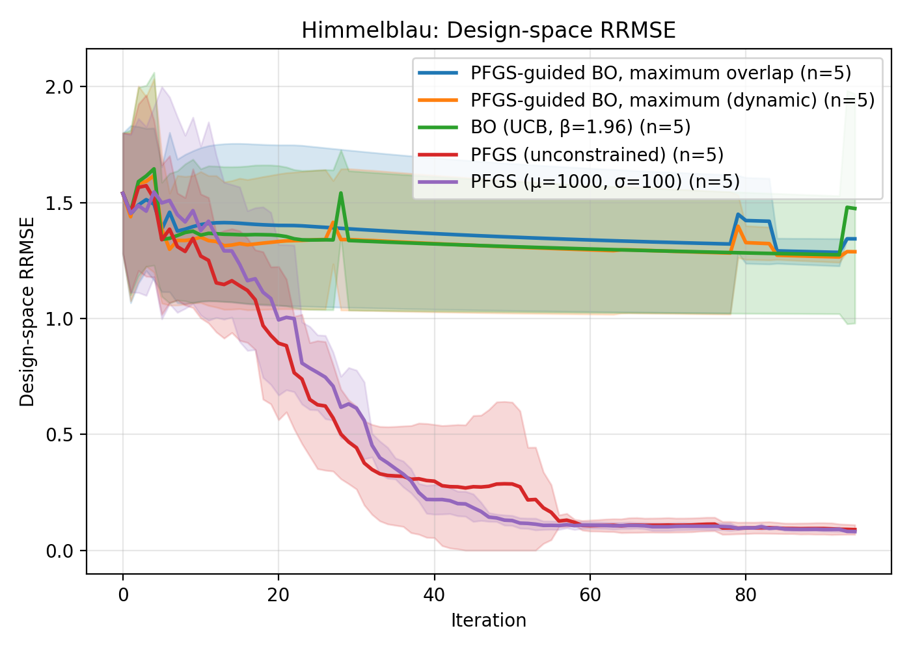
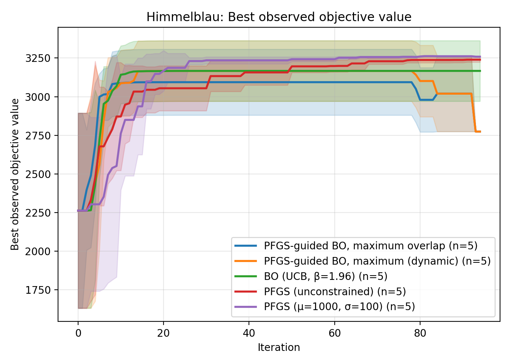
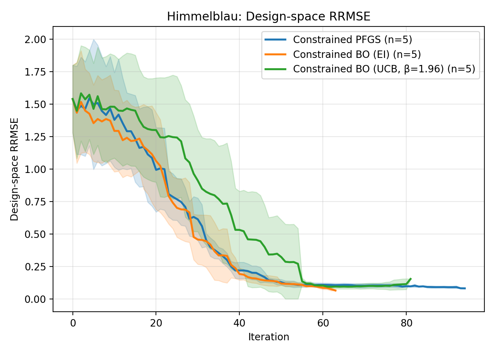
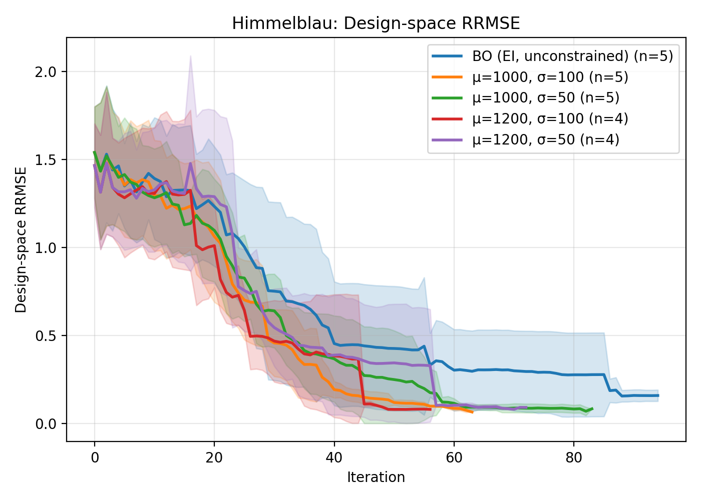
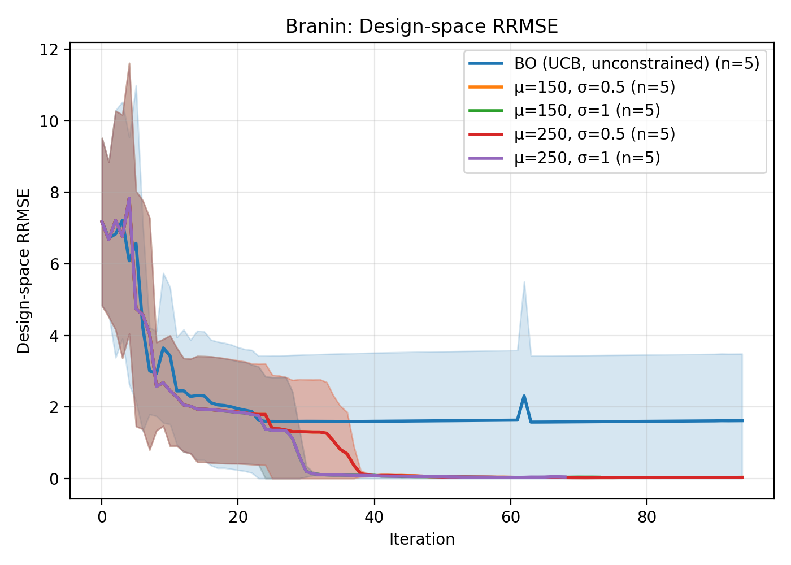
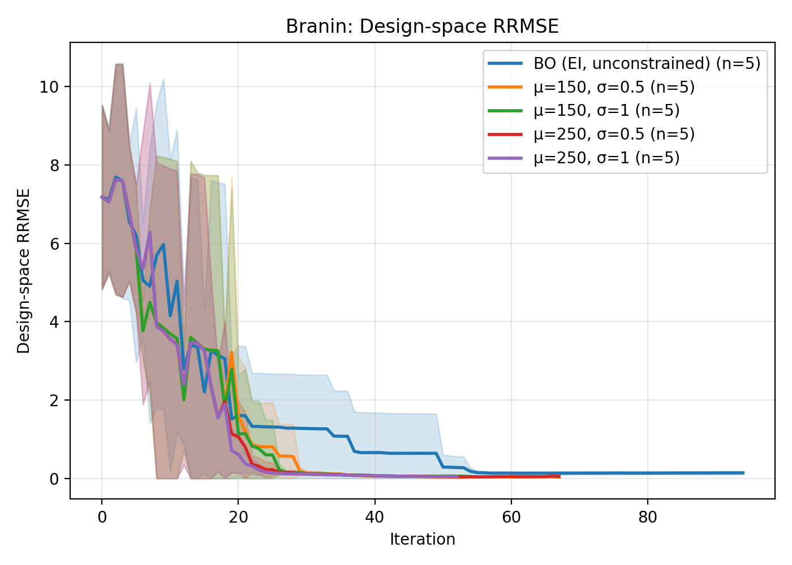
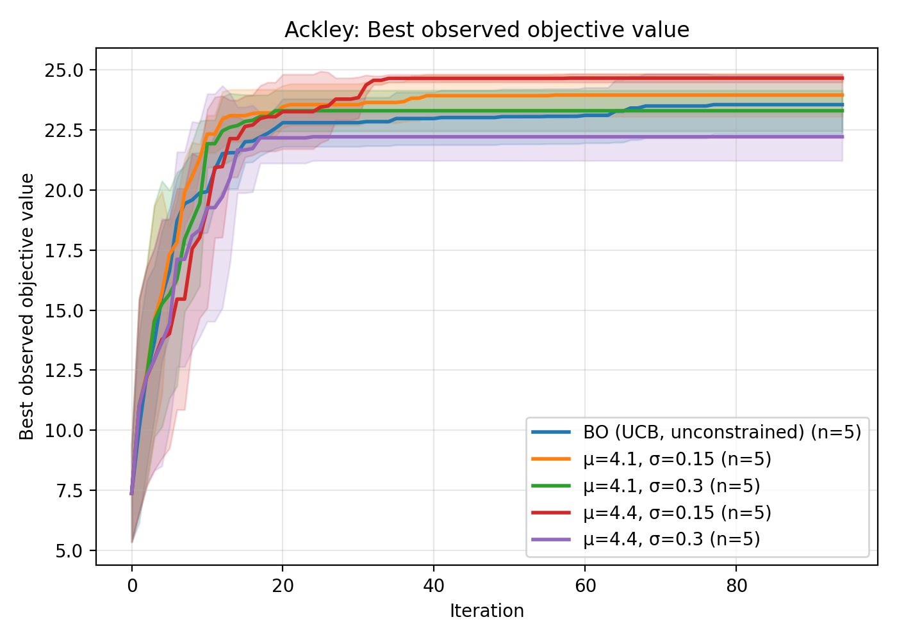
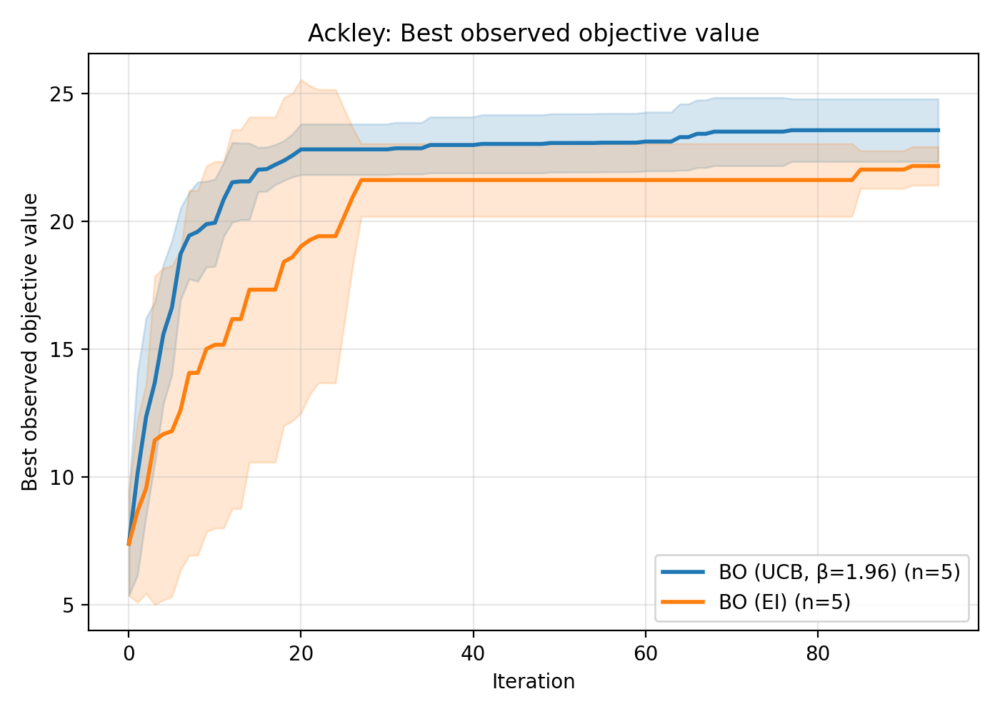
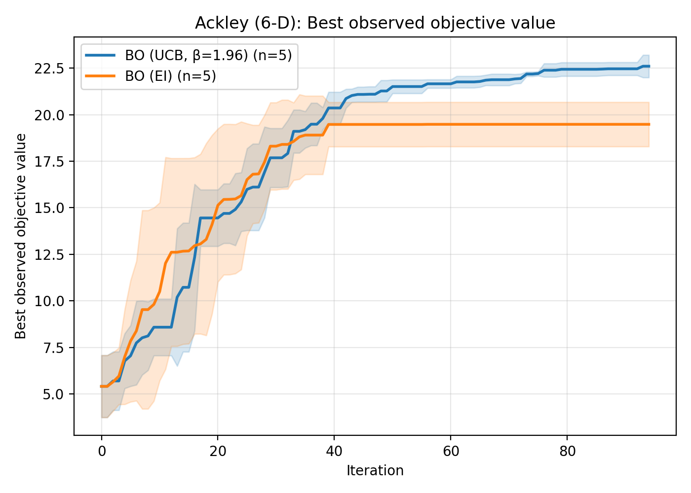
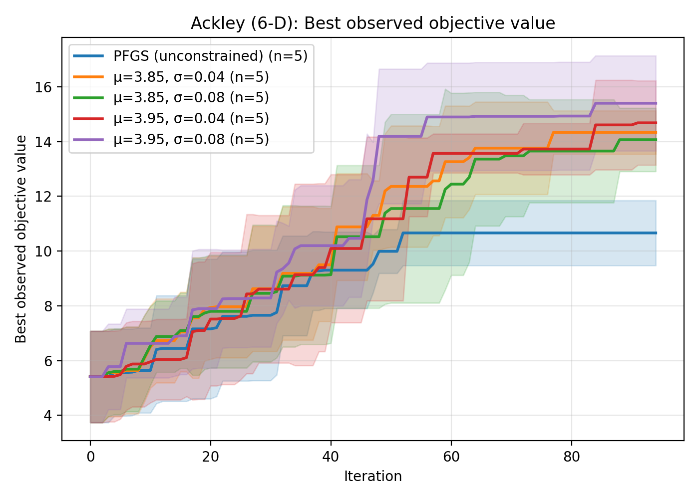

# Incorporating Pareto Front Guided Sampling Principles into Bayesian Optimisation

[](https://github.com/TiaraAnnaJain/pfgs-bayesian-optimisation/actions/workflows/ci.yml)
[](https://www.python.org/)
[](LICENSE)

Bayesian Optimisation (BO) [1] requires manually selected exploration parameters and provides limited insight into the exploration-exploitation trade-off. Pareto Front Guided Sampling (PFGS) [2] exposes this trade-off explicitly through a Pareto front of the Gaussian Process (GP) mean and uncertainty.

This project uses the PFGS framework of Stricker et al. [2] to inspire BO in two ways:

- **PFGS-guided BO:** using the Pareto front generated by PFGS to determine suitable values of the exploration parameter β in the Upper Confidence Bound (UCB) acquisition function.
- **Constrained BO:** introducing constraints in the prediction space so that BO only considers points satisfying minimum predicted mean and uncertainty thresholds.

Both are compared with PFGS and standard BO (UCB and Expected Improvement) on the Himmelblau, Branin and Ackley (2-D and 6-D) benchmark functions. This was an undergraduate research project.

## Key findings

- **PFGS-guided BO achieved surrogate accuracy comparable to or slightly better than traditional UCB, but PFGS remained the strongest-performing approach.** On Himmelblau, the design-space RRMSE was 1.27–1.32 for the six β strategies, 1.48 for UCB and 0.09 for PFGS.
- **Not all Pareto-front points can be represented by UCB through a valid β, particularly for non-convex fronts.** 42–67% of PFGS iterations on Himmelblau had no valid β.
- **Constrained BO generally improved surrogate accuracy while maintaining comparable optimisation performance.** Design-space RRMSE was 0.08 against 0.16 for unconstrained EI on Himmelblau, and 0.02–0.06 against 0.14 on Branin.
- **Increasing the mean threshold delayed surrogate accuracy. Increasing the standard-deviation threshold accelerated it, but made runs terminate earlier.**
- **On 2-D Ackley, constraints improved the optimisation itself.** Constrained UCB came within 1 of the global maximum on 5/5 seeds, against 2/5 for UCB and 0/5 for EI.
- **The methods do not scale to 6-D Ackley as they are** (see [Limitations](#limitations)).

## Method

### PFGS-guided BO

$$\mathrm{UCB}(x) = \mu(x) + \beta\,\sigma(x)$$

At each PFGS iteration, β is derived as the range of values for which the selected Pareto-front point $x^{\ast}$ has the highest UCB value [3]. This requires, for every other candidate $x_i$:

$$\mu(x^{\ast}) + \beta\,\sigma(x^{\ast}) \ \ge\ \mu(x_i) + \beta\,\sigma(x_i)$$

Candidates with lower uncertainty than $x^{\ast}$ give lower bounds on β, and those with higher uncertainty give upper bounds. If there is no lower bound, β_min = 0. If there is no upper bound, β_max = ∞. If the bounds cross, there is no valid β. This happens when $x^{\ast}$ is not on the convex hull of the Pareto front.

The β intervals define two scheduling approaches for standard BO:

- **Dynamic schedule**, where β is updated at each BO iteration using the corresponding PFGS interval:
  - minimum β: the lower bound of the interval
  - maximum β: the upper bound of the interval
  - midpoint β: the midpoint of the interval
- **Fixed schedule**, where a single β is used throughout BO:
  - mean β: mean of all interval midpoint values
  - median β: median of all interval midpoint values
  - maximum-overlap β: the β value contained within the greatest number of intervals

**Implementation details:**

- **Carrying β forward:** when an interval is invalid or unbounded, the previous viable β is carried forward, starting from β = 1.96.
- **Run length:** PFGS-guided BO runs one iteration per PFGS interval, so it stops when the PFGS run that produced β stopped.
- **Ties:** tied maximum-overlap ranges are each run separately.
- **Source of β:** β comes from a PFGS run with baseline constraints (µ = 1000, σ = 100 on Himmelblau).

### Constrained BO

A GP is fitted, and the acquisition function (UCB with β = 1.96, or EI) is filtered by a feasibility mask that removes candidates with a predicted mean or uncertainty below the thresholds. The remaining candidates are optimised with **Particle Swarm Optimisation (PSO)** [4]. The algorithm terminates early if the mask discards every candidate, which can occur as GP uncertainty decreases.

**Why PSO?** The feasibility mask creates discontinuous, non-differentiable regions in the acquisition landscape. Gradient-based optimisers can struggle or become trapped near these masked regions, whereas PSO does not require gradient information.

## Experimental setup

| Problem (adapted to maximisation) | Domain | Global maximum | Thresholds: µ | Thresholds: σ |
|---|---|---|---|---|
| Himmelblau, $\exp(8 - 0.01(f + x_1 - 2x_2))$ | $[-5, 5]^2$ | ≈ 3265 | 1000, 1200 | 50, 100 |
| Branin, $400 - f$ | $[-5, 10] \times [0, 15]$ | 399.6 | 150, 250 | 0.5, 1 |
| Ackley 2-D, $25 - f$ | $[-32.768, 32.768]^2$ | 25 | 4.1, 4.4 | 0.15, 0.3 |
| Ackley 6-D, $25 - f$ | $[-32.768, 32.768]^6$ | 25 | 3.85, 3.95 | 0.04, 0.08 |

- **Himmelblau tilt:** the $x_1 - 2x_2$ term gives Himmelblau one global and three local maxima.
- **Thresholds:**
  - The Himmelblau and Branin thresholds are from the original study.
  - The Ackley thresholds match Himmelblau's strictness.
  - Every threshold pair is used for both PFGS and constrained BO.
- **Data and budget:**
  - 5 initial samples from Latin Hypercube Sampling [5] and 95 iterations.
  - 5 seeds per configuration.
  - Curves show the mean ± 1 standard deviation.
- **Models:**
  - GP: BoTorch `SingleTaskGP` [6, 7].
  - Pareto fronts: NSGA-II [8] from pymoo [9].
  - Constrained BO: PSO from PySwarms [4].
- **Metrics:**
  - RRMSE = RMSE / std(y) on an entire-space test set and a design-space test set (±1.5 around each maximum), each of 100 points. An RRMSE of 1 is as good as predicting the test-set mean.
  - The best observed objective value.

## Results

Numbers are the mean ± standard deviation of each run's final value over seeds. All figures and a `summary.csv` per problem are in [`results/`](results/). Curves average only the runs still going at each iteration, so they can shift when a run terminates early.

### Himmelblau: PFGS-guided BO

| Method | Design-space RRMSE | Best observed value | Iterations |
|---|---|---|---|
| PFGS (unconstrained) | **0.089 ± 0.021** | 3239 ± 16 | 95 |
| BO, UCB (β = 1.96) | 1.475 ± 0.495 | 3167 ± 196 | 95 |
| PFGS-guided BO, maximum (dynamic) | 1.274 ± 0.263 | 3167 ± 196 | 86.2 |
| PFGS-guided BO, maximum-overlap (fixed) | 1.315 ± 0.298 | 3094 ± 213 | 86.2 |
| PFGS-guided BO, other four strategies | 1.288–1.319 | 3094–3167 | 86.2 |

<p align="center">
  
  
</p>

All six strategies were slightly more accurate than UCB, but did not find the global maximum more reliably. The fixed strategies all settled on β ≈ 0.9–1.1, so there was little to separate them.

### Himmelblau: constrained BO

| Method | µ, σ | Design-space RRMSE | Best observed value | Iterations |
|---|---|---|---|---|
| BO, EI | none | 0.158 ± 0.032 | 3265 ± 0 | 95 |
| Constrained BO, EI | 1000, 50 | 0.077 ± 0.023 | 3260 ± 3 | 82.4 |
| Constrained BO, EI | 1000, 100 | 0.083 ± 0.013 | 3226 ± 37 | 62.8 |
| Constrained BO, UCB | 1000, 50 | **0.063 ± 0.028** | 3244 ± 18 | 95 |
| PFGS | 1000, 100 | 0.099 ± 0.018 | 3259 ± 6 | 86.2 |
| Constrained BO, EI | 1200, 50 | 0.724 ± 0.756 (n = 4) | 3165 ± 164 | 56.3 |

<p align="center">
  
  
</p>

- **At µ = 1000:** constrained EI and constrained PFGS closely track one another, and both outperform unconstrained EI.
- **At µ = 1200:** the mean threshold excludes the global optimum on some seeds. Two seeds terminate early, and one is discarded at the first iteration.

### Branin

| Method | Design-space RRMSE | Entire-space RRMSE | Iterations |
|---|---|---|---|
| BO, EI | 0.141 ± 0.038 | 0.337 | 95 |
| BO, UCB | 1.614 ± 1.870 | 0.580 | 95 |
| Constrained BO, EI (all 4 thresholds) | 0.042–0.055 | 0.005–0.022 | 52–67 |
| Constrained BO, UCB (all 4 thresholds) | **0.024–0.031** | 0.009–0.045 | 65–94 |
| PFGS (all 4 thresholds) | 0.061–0.104 | 0.005–0.009 | 48–57 |

<p align="center">
  
  
</p>

Every method gets within 0.5 of the global maximum, so they differ mainly in surrogate accuracy, where every constrained configuration beats unconstrained BO.

### Ackley 2-D

| Method | µ, σ | Entire-space RRMSE | Best observed value | Seeds within 1 of max |
|---|---|---|---|---|
| BO, EI | none | **0.368** | 22.2 ± 0.8 | 0/5 |
| BO, UCB | none | 2.504 | 23.6 ± 1.2 | 2/5 |
| PFGS | none | 0.766 | 23.2 ± 0.6 | 1/5 |
| Constrained BO, UCB | 4.4, 0.15 | 2.510 | **24.7 ± 0.2** | **5/5** |
| Constrained BO, EI | all 4 | 0.40–0.48 | 22.6–23.5 | |

<p align="center">
  
  
</p>

On this multimodal function, constrained UCB at µ = 4.4, σ = 0.15 reached the global peak on every seed, within 11–33 iterations. The EI-based methods gave the most accurate surrogates.

### Ackley 6-D

| Method | Entire-space RRMSE | Best observed value |
|---|---|---|
| BO, EI | 1.49 | 19.5 ± 1.2 |
| BO, UCB | 3.10 | **22.6 ± 0.6** |
| PFGS (all thresholds) | **0.72–0.84** | 10.7–15.4 |
| Constrained BO, EI (all 4 thresholds) | 0.98–1.67 | 17.4–18.8 |
| Constrained BO, UCB (all 4 thresholds) | 1.20–1.38 | 18.2–18.7 |

<p align="center">
  
  
</p>

No method came within 1 of the global maximum. PFGS gave the most accurate surrogate but the worst optimisation, and constrained BO no longer gave a clear benefit.

## Limitations

- **One β cannot represent every Pareto-front selection.** UCB is linear in mean and uncertainty, so only points on the convex hull of the front have a valid β. The dynamic strategies therefore spend much of the run on carried-forward values.
- **The fixed β strategies converge.** On Himmelblau, the mean, median and maximum-overlap strategies all land on β ≈ 1.
- **Runs that terminate immediately are excluded.** If every candidate is discarded at the first iteration, the run has no results. This happened for Himmelblau at µ = 1200, seed 2, and flatters the strictest settings.
- **Thresholds are problem-specific and fixed.** They are in the objective's units and have to be tuned per problem.
- **Scaling to 6-D Ackley:**
  - **σ thresholds stop mattering:** the GP's uncertainty never drops low enough for σ = 0.04 or 0.08 to bind, so pairs that differ only in σ give identical results.
  - **Design-space RRMSE breaks down:** the design region covers about 10⁻⁸ of the domain and is never sampled, so entire-space RRMSE is reported instead.

## Reproducing the results

Requires Python 3.13 and [uv](https://docs.astral.sh/uv/).

```bash
git clone https://github.com/TiaraAnnaJain/pfgs-bayesian-optimisation.git
cd pfgs-bayesian-optimisation
uv sync
```

**Run everything** (330 runs, about 1–1.5 hours with 4 runs at a time), then build the figures and summary tables:

```bash
uv run python scripts/run_experiments.py --jobs 4 --skip-existing
uv run python scripts/make_figures.py
```

`--dry-run` lists the commands, and `--experiment`, `--problem` and `--seeds` run a subset.

**Run a single experiment.** Each script takes a config from `configs/`. Any value can be overridden with `--set key=value`.

```bash
# PFGS (also saves the β intervals used by PFGS-guided BO)
uv run python scripts/run_pfgs.py --file pfgs.toml --problem himmelblau --train-seed 1 \
    --set mean_discard_threshold=1000 --set std_dev_discard_threshold=100

# PFGS-guided BO, with one β schedule
uv run python scripts/run_pfgs_bo.py --file pfgs_bo.toml --problem himmelblau --train-seed 1 \
    --set schedule=max_overlap

# Constrained BO (constrained_bo_ucb.toml or constrained_bo_ei.toml)
uv run python scripts/run_constrained_bo.py --file constrained_bo_ucb.toml --problem ackley \
    --dimensions 6 --set mean_discard_threshold=3.95 --set std_dev_discard_threshold=0.08

# Standard BO (bo_ucb.toml or bo_ei.toml)
uv run python scripts/run_bo.py --file bo_ei.toml --problem branin
```

**Outputs:**

- Each run writes per-iteration metrics to `results/<problem>/…/train_seed_<n>.csv`.
- Each run is also logged to MLflow, with GP and Pareto-front plots at every iteration. View them with `uv run mlflow ui --backend-store-uri sqlite:///mlflow.db`.

**Tests** (also run in CI):

```bash
uv run pytest && uv run ruff check && uv run mypy
```

## Repository structure

```
configs/          TOML config per method
scripts/          run_* entry points, run_experiments.py, make_figures.py
src/pfgs_bo/
  data/           benchmark functions, LHS sampling, test sets, normalisation
  pareto_front/   NSGA-II Pareto front, filtering and selection, β derivation and schedules
  bo/             acquisition functions, BoTorch optimiser, masked acquisition with PSO
  tracking/       MLflow logging, results and β input/output
  plotting/       figures
tests/            unit and integration tests
results/          per-run CSVs, summary tables and figures
```

## References

[1] P. I. Frazier, "A tutorial on Bayesian optimization," arXiv:1807.02811, 2018.

[2] S. Stricker, L. F. dos Santos, C. Wirnsperger, A. Butté, A. del Rio Chanona, M. Mercangöz, and G. Guillén-Gosálbez, "Pareto front guided sampling for efficient bioprocess experimentation," in *ESCAPE 36 – European Symposium on Computer Aided Process Engineering*, Sheffield, UK, 2026. [doi:10.69997/sct.137011](https://doi.org/10.69997/sct.137011). Code: [samstricker/pfgs-optimization](https://github.com/samstricker/pfgs-optimization).

[3] F. Archetti and A. Candelieri, "The acquisition function," in *Bayesian Optimization and Data Science*, SpringerBriefs in Optimization. Springer, 2019, ch. 4, pp. 57–72.

[4] L. J. Miranda, "PySwarms: a research toolkit for particle swarm optimization in Python," *Journal of Open Source Software*, vol. 3, no. 21, p. 433, 2018.

[5] P. Virtanen et al., "SciPy 1.0: Fundamental algorithms for scientific computing in Python," *Nature Methods*, vol. 17, pp. 261–272, 2020.

[6] C. E. Rasmussen and C. K. I. Williams, *Gaussian Processes for Machine Learning*. The MIT Press, 2005.

[7] M. Balandat, B. Karrer, B. Letham, A. G. Wilson, and E. Bakshy, "BoTorch: A framework for efficient Monte-Carlo Bayesian optimization," arXiv:1910.06403, 2020.

[8] K. Deb, A. Pratap, S. Agarwal, and T. Meyarivan, "A fast and elitist multiobjective genetic algorithm: NSGA-II," *IEEE Transactions on Evolutionary Computation*, vol. 6, no. 2, pp. 182–197, 2002.

[9] J. Blank and K. Deb, "pymoo: Multi-objective optimization in Python," *IEEE Access*, vol. 8, pp. 89497–89509, 2020.

## Citation and licence

Please cite this repository using [`CITATION.cff`](CITATION.cff), and cite the PFGS framework it builds on [2]. Released under the [MIT License](LICENSE).
